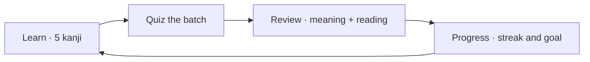

# Kanji Tree

<p align="center">
  <strong style="font-size: 2rem; letter-spacing: 0.4em;">木 → 林 → 森</strong>
</p>

<p align="center">
  One tree. Then a grove. Then a forest.<br>
  See how a kanji is built, and still know it next month.
</p>

The tree is the map. Your account is the memory. Learn a handful of characters, grade them honestly, and come back when they are about to slip.



**A first sitting**

1. Create an account from **Log in** in the header.
2. Open **Learn**. Parts come before the kanji built from them, so 木 arrives before 林.
3. Open **Review**. Easy cards wait. Missed cards come back today.
4. Open **Progress**, pick a JLPT level, and see the date you will have started them all.

|                  | Go here when you want to…                             |
| ---------------- | ----------------------------------------------------- |
| **Explorer**     | Climb one character and see what it is made of        |
| **Common kanji** | Start from the characters newspapers actually use     |
| **Learn**        | Meet five new kanji, then prove you can pick them out |
| **Review**       | Bring back the ones that are due                      |
| **Quiz**         | Drill, without pushing cards further away             |
| **Progress**     | See the streak, the coverage, and the finish line     |

Explorer and Common kanji work before you have an account. Learn, Review, Quiz, and Progress keep your study, so they ask you to log in. After that, the characters you are studying light up on the tree and on the grid.

## Learn

Five kanji. A keyword, the parts, the primary readings, a few real words, and a mnemonic box that already holds the English keyword. Change it into something you will actually picture.

**Quiz me** asks which character matches a meaning. Miss one and it returns at the end, so you finish the batch having got it right. Those kanji then join your reviews.

The next five stay inside your target JLPT level when they can, prefer common characters, and wait until you know the parts. Already know one? **I already know** marks it known on the spot.

## Review

Every kanji has two cards. One asks for the meaning. One asks for the reading. Your mnemonic shows up with the answer.

| Grade           | You felt…         | What happens                          |
| --------------- | ----------------- | ------------------------------------- |
| **Again** · `1` | Blank             | It returns later in this same session |
| **Hard** · `2`  | You fought for it | It comes back soon                    |
| **Good** · `3`  | You knew it       | The gap grows                         |
| **Easy** · `4`  | Instant           | It can wait weeks                     |

Space or Enter shows the answer. At the end: how many you remembered, how long it took, and common words you can now read because every kanji in them is one you are keeping.

## Quiz

Five ways to poke at the same characters. None of them move your review dates.

|                  | You are shown…                                  |
| ---------------- | ----------------------------------------------- |
| **Meaning**      | A sense, and you pick the kanji                 |
| **Reading**      | A character, and you pick the reading           |
| **Word reading** | A real word, and you pick how it is read        |
| **Okurigana**    | A kun reading split by a dot, like た**.**べる  |
| **Stroke count** | A character, and you pick the number of strokes |

The wrong answers are look-alikes: a sibling in the tree, a kanji with the same reading, or one with the same stroke count. Anything you miss links straight back into Explorer.

## Progress

The top row is today: due now, new cards left, kanji you know, kanji you are still studying, and your streak. Review today or the streak pauses.

Set a **target JLPT level** and **new cards per day**. Each kanji is two cards, meaning and reading, so 10 new cards starts 5 kanji. The page then names the day you will have started every kanji up to that level.

Under that, the longer view:

- A year of days. Darker green, more reviews.
- Meaning and reading accuracy for the last 7 days and the last 30.
- Reviews waiting on each of the next 14 days.
- New kanji started each week.
- How much of each JLPT level, school year, and the Jōyō list you know.
- How many of the top newspaper kanji you know.
- **Reading families**, other Jōyō kanji that share a reading with ones you just studied. Learn ショウ once, then collect the rest.
- **Words you can read**, common words made only of kanji you have already passed.
- **Leeches**, cards forgotten 8 times or more. Open one and write a sharper mnemonic, or ignore it.

**Your data** downloads a JSON file you can import again, or a CSV with one row per card.

## On the tree

Open any character. Four buttons decide its fate.

|                    |                                                       |
| ------------------ | ----------------------------------------------------- |
| **Start learning** | It joins the next review                              |
| **I know this**    | Known now, and it still drops by about every 3 weeks  |
| **Ignore**         | Out of reviews, until you tap **Stop ignoring**       |
| **Remove**         | That kanji and its history are gone                   |
| **Mnemonic**       | Your hint, shown again on the answer side of the card |

The dot beside the buttons, and the fill of the box, use the same scale:

|              |                                    |
| ------------ | ---------------------------------- |
| **New**      | Queued for the next review         |
| **Learning** | Back within a day                  |
| **Young**    | Every few days                     |
| **Known**    | Three weeks or more between visits |
| **Ignored**  | Sitting out                        |

On Common kanji, the same colors become a ring and a small badge. **Hide known kanji** clears the ones that are already green.

## Explorer

The tree opens on 木. Each box is a kanji. The badge is its JLPT level, N5 easiest through N1 hardest. A pink **R** is a radical.

Drag to move. Scroll or pinch to zoom. Tap a box for details. Tap the red circle to grow or fold the kanji built from it. Search a character or a reading such as ボク, then tap a result to center the tree there.

Inside the details:

|                              |                                                                                                                                          |
| ---------------------------- | ---------------------------------------------------------------------------------------------------------------------------------------- |
| **Keyword**                  | The English hint for this character                                                                                                      |
| **Stroke count**             | Plus **other stroke counts** when a second, usually wrong, count exists                                                                  |
| **JLPT** and **school year** | Years 1–6 are elementary. Secondary is Jōyō after that. Jinmeiyō are name kanji                                                          |
| **Newspaper rank**           | 1 is the most common in the Mainichi Shinbun list. 2,501 characters have a rank                                                          |
| **Meanings**                 | The senses                                                                                                                               |
| **On, kun, name-only**       | The first on and the first kun are **Primary**. Learn those first. Tap any reading to see the other kanji that use it, common ones first |
| **Words**                    | The word, its reading, its meaning                                                                                                       |
| **Center the tree on**       | Redraw with this kanji as the root                                                                                                       |
| **How it is formed**         | White is the one you are viewing. Pink is the part that was added. Tap a dark character to open it                                       |
| **Built from this one**      | The kanji that grow out of it                                                                                                            |
| **Notes**                    | When the dictionary has something worth keeping                                                                                          |

## Common kanji

A grid you can tap straight into the tree. Ranked from the Mainichi Shinbun, where #1 is the character you will meet most often.

- **Top 20** through **Top 1000** follow that rank.
- **Year 1–6** and **Secondary** follow the school lists, still most common first.
- **N5–N1** narrows either list. **All** lifts the filter.
- A rank range and a school year are separate. Picking one clears the other.
- **Load 20 more** continues the list.
- **Hide known kanji** leaves the grid full of characters you have not finished yet.

## Run it

```bash
bun install
bun run dev
```

Open `http://localhost:3000`.

`bun run build:kanji-graph` rebuilds the tree, JLPT levels, school years, and newspaper ranks from [kanjiapi.dev](https://kanjiapi.dev).
